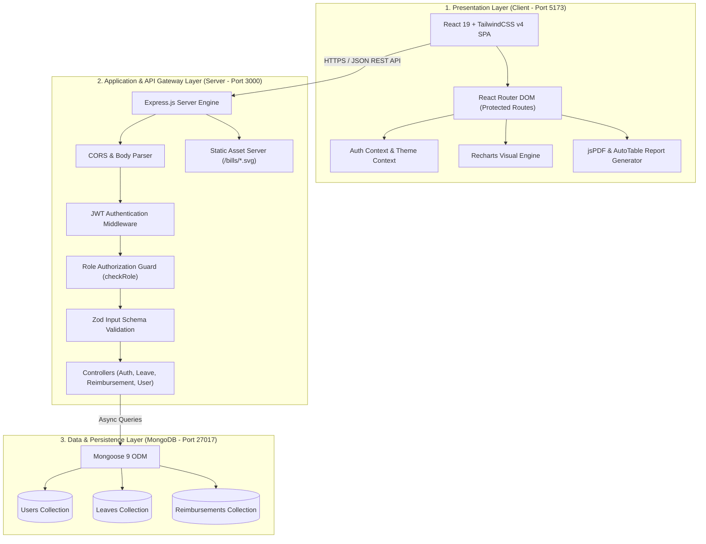
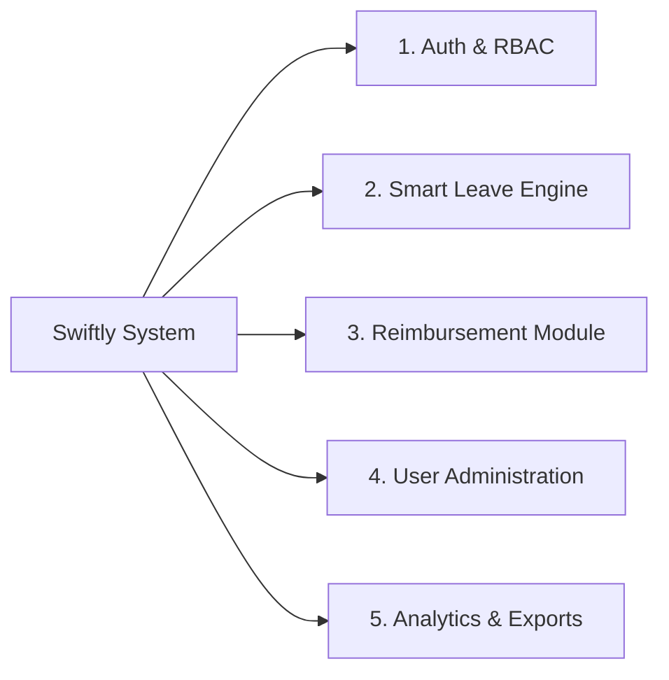
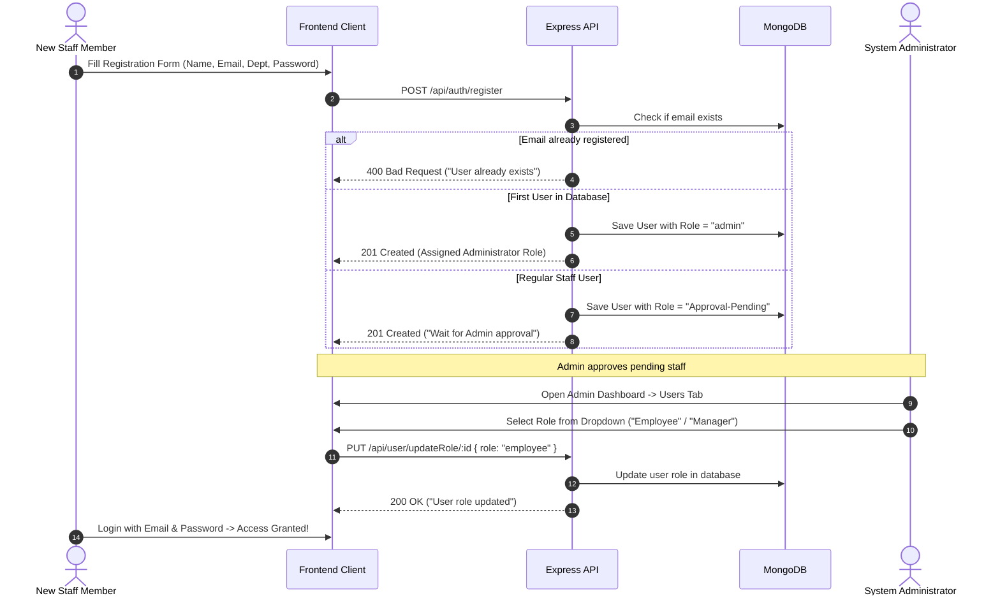
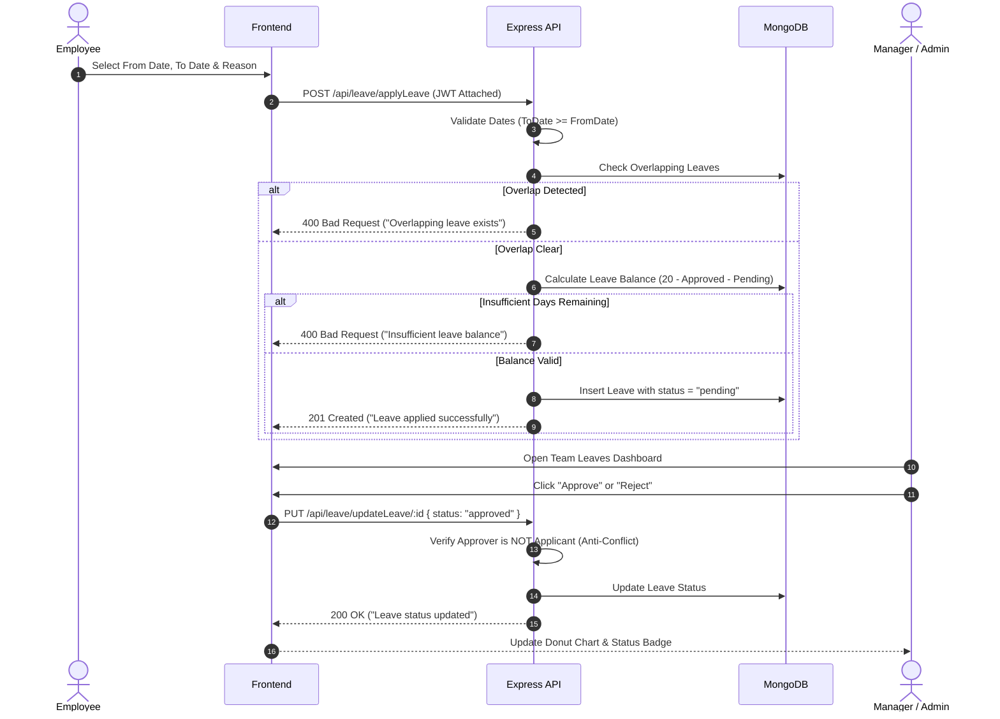
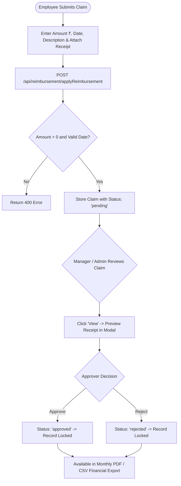

# 🏛️ System Architecture & Engineering Documentation
## Swiftly — Employee Leave & Reimbursement Portal

---

## 1. 📌 System Overview

### 1.1 Executive Summary
**Swiftly** is a secure, full-stack enterprise web portal engineered to modernize and automate core human resource operations—specifically **Employee Leave Management** and **Expense Reimbursement Processing**. 

In conventional organizational setups, leave requests and operational expense reimbursements are managed through fragmented communication channels (email threads, paper slips, or shared spreadsheets). This causes severe operational overhead: untracked leave balances, lost receipts, delayed approvals, lack of audit trails, and financial governance risks.

**Swiftly resolves these challenges by introducing:**
* Centralized, role-based workflows for **Employees**, **Managers**, and **System Administrators**.
* An automated **Leave Quota Engine** that enforces overlap prevention, date validity, and real-time balance deductions.
* An integrated **Digital Receipt Management System** capable of hosting and verifying proof-of-payment documents (tax invoices, flight itineraries, cab receipts).
* Dynamic analytics (status donut charts) and one-click data extraction (**CSV spreadsheets** and **PDF reports**).

---

## 2. 🏗️ High-Level System Architecture

Swiftly is built using a modern **Decoupled Multi-Tier Architecture** consisting of a React Single-Page Application (SPA) on the client side, a RESTful Node.js/Express service on the backend, and a document-oriented MongoDB database for persistence.



### Architectural Highlights:
1. **Stateless Authorization**: Client sessions are maintained via JSON Web Tokens (JWT) signed with HMAC-SHA256. The server does not maintain server-side session stores, enabling horizontal scalability.
2. **Client-Side Protected Routing**: Route transitions on the frontend check the decoded JWT role in `AuthContext` before rendering restricted views (Employee, Manager, Admin).
3. **Decoupled Static Asset Hosting**: Vector receipts and bills are hosted via Express static routing and client asset pipelines, eliminating third-party CDN downtime and external 404 errors.

---

## 3. 🧩 Core Functional Modules



### 3.1 Authentication & Role-Based Access Control (RBAC) Module
* **Password Encryption**: Sensitive passwords are salted and hashed using **bcryptjs** with 10 salt rounds.
* **JWT Token Issuance**: On successful credential verification, an encrypted JWT with a 2-hour validity window is issued.
* **RBAC Enforcement**: API routes are gated by `checkRole(['employee', 'manager', 'admin'])`.
* **Self-Bootstrapping Mechanism**: When the system is initialized on a clean database, the very first user who registers is automatically granted the `admin` role. All subsequent registrations are placed into an `Approval-Pending` state.

### 3.2 Smart Leave Management & Quota Engine
* **Date Normalization**: Dates are parsed to UTC midnight timestamps to prevent cross-timezone miscalculations.
* **Overlap Protection**: Queries the database to ensure an employee does not hold an active (`pending` or `approved`) leave request overlapping with the requested date range:
  $$\text{Query: } (\text{fromDate} \le \text{req.toDate}) \land (\text{toDate} \ge \text{req.fromDate})$$
* **Dynamic Quota Calculation**: Each employee starts with an annual pool (default: 20 days). Available days are dynamically evaluated:
  $$\text{Available Days} = \text{Total Allocated} - \text{Approved Days} - \text{Pending Days}$$
* If $\text{Requested Days} > \text{Available Days}$, the transaction is rejected with an explanatory message.

### 3.3 Expense Reimbursement & Digital Document Module
* **Expense Ingestion**: Accepts claims specifying amount in INR (₹), expense date, category description, and receipt file.
* **Document Management**: Locally hosts SVG/PDF invoices (Ola cab rides, IndiGo flights, Airtel broadband, Barbeque Nation team dinners).
* **Audit Locking**: While a claim is `pending`, the owner can replace or remove their receipt. Once `approved` or `rejected`, the record is locked to prevent tampering.

### 3.4 Governance & Conflict-of-Interest Safeguards
* **Anti-Self-Approval Guard**: Managers and administrators cannot approve or reject their own leave applications or reimbursement claims.
* **Account Deletion Protection**: Administrators cannot delete their own active account, and the last remaining administrator account cannot be deleted.

### 3.5 Visual Analytics & Report Generation Engine
* **Real-Time Donut Visualizations**: Uses `Recharts` to compute and render SVG status distributions (Approved vs. Pending vs. Rejected).
* **Client-Side Document Compilation**: Leverages `jspdf` and `jspdf-autotable` to generate formatted PDF summary tables directly in the browser without server CPU overhead.

---

## 4. 🔄 End-to-End User Flows

### 4.1 User Registration & Admin Onboarding Flow


---

### 4.2 Leave Application & Approval Flow


---

### 4.3 Expense Reimbursement & Receipt Audit Flow


---

## 5. ⚙️ Engineering Methodology & Design Patterns

| Pattern / Principle | Implementation in Swiftly | Benefit |
|:---|:---|:---|
| **MVC Separation** | Mongoose Models (`models/`), Express Routes (`routes/`), Business Controllers (`controllers/`) | Clean separation of business logic from transport layers |
| **Stateless Client-Server** | JSON Web Tokens passed in `Authorization: Bearer <token>` headers | Zero server session memory leaks; easily clusterable |
| **Defensive Validation** | Zod schemas validate payload types before hitting database controllers | Rejects malformed requests with granular validation error lists |
| **Anti-Conflict Guards** | Checks `applicant.id !== approver.id` inside leave and expense handlers | Prevents fraud and self-approval of claims |
| **Concurrency Orchestration** | Node child process spawner ([`dev.js`](file:///D:/Work%20Folder/college/College%20Labs/SE/EmployeeLeave_SE/dev.js)) | One-command execution of both Vite and Express pipelines |

---

## 6. 💻 Comprehensive Technology Stack

### 6.1 Frontend Technologies
| Tool / Library | Version | Role in Architecture |
|:---|:---:|:---|
| **React** | 19.2.0 | Declarative component-based user interface |
| **Vite** | 7.3.1 | Next-generation frontend build tool and hot-module replacement |
| **TailwindCSS** | 4.2.1 | Utility-first styling engine with native dark-mode tokens |
| **React Router DOM** | 7.15.0 | Client-side routing with role-guarded route boundaries |
| **Recharts** | 3.7.0 | Declarative SVG donut/pie charts for approval analytics |
| **jsPDF & AutoTable** | 4.2.1 / 5.0.8 | In-browser PDF report rendering and document formatting |
| **React Hot Toast** | 2.6.0 | Non-blocking real-time feedback notifications |
| **Axios** | 1.13.5 | Promise-based HTTP client with automatic auth headers |

### 6.2 Backend Technologies
| Tool / Library | Version | Role in Architecture |
|:---|:---:|:---|
| **Node.js** | 24.18.0 | High-performance asynchronous JavaScript runtime |
| **Express.js** | 5.2.1 | REST API routing and middleware framework |
| **Mongoose** | 9.2.1 | Schema-based Object Data Modeling (ODM) for MongoDB |
| **JSON Web Token** | 9.0.3 | Cryptographic token creation and signature verification |
| **bcryptjs** | 3.0.3 | One-way password salt generation and hashing |
| **Zod** | 4.4.3 | Runtime data schema validation |
| **Multer** | 2.0.2 | Multipart/form-data handler for binary bill uploads |
| **Nodemon** | 3.1.14 | Development auto-restart monitor |

### 6.3 Database & Storage
| Component | Specification | Description |
|:---|:---:|:---|
| **MongoDB** | v8.2+ | Document database storing Users, Leaves, and Reimbursements |
| **Local Vector CDN** | `/bills/*.svg` | Locally served, zero-dependency, high-res invoice assets |

---

## 7. 🚀 Execution & Verification

### Unified Development Command
From the project directory, run:

```bash
npm run dev
```

* **Frontend UI**: `http://localhost:5173`
* **Backend API**: `http://localhost:3000`
* **Default Database Port**: `127.0.0.1:27017`
* **All Pre-Configured Passwords**: `123456`

